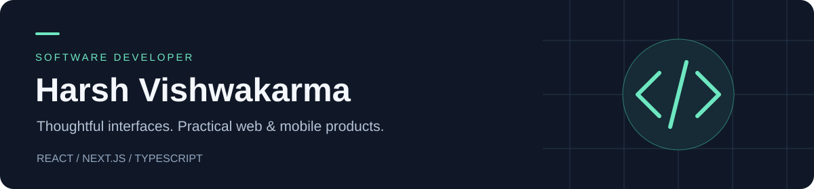

  <a href="https://hv443-portfolio.vercel.app/"><strong>Portfolio</strong></a> &nbsp; · &nbsp;
  <a href="https://linkedin.com/in/hv443"><strong>LinkedIn</strong></a> &nbsp; · &nbsp;
  <a href="mailto:vishwakarmaharsh443@gmail.com"><strong>Email me</strong></a>

## Hi, I'm Harsh

I'm a **Software Developer based in Mumbai, India**, focused on frontend engineering with **React, Next.js, and TypeScript**. I also build mobile applications with Flutter and work across the stack with Node.js and Express.

My work spans booking platforms, logistics products, and home-service applications—from responsive interfaces and application state to API integration and real-time communication.

**Interested in frontend and full-stack opportunities.** [Let's connect →](mailto:vishwakarmaharsh443@gmail.com)

## Selected work

### ShiftBOOKD · Beauty & barber appointment platform

Built responsive React interfaces for bookings, profiles, and messaging. Managed application state with Redux, integrated REST APIs and real-time chat with Socket.io, and deployed the application on AWS EC2.

**React · TypeScript · SCSS · Redux · Socket.io · AWS EC2**

[View in my portfolio ↗](https://hv443-portfolio.vercel.app/)

### UseToo Logistics · Logistics web & mobile experience

Work across a logistics website and mobile workflows, with interfaces for services, shipment tracking, and customer interactions.

**Next.js · React · Tailwind CSS · React Native**

[View in my portfolio ↗](https://hv443-portfolio.vercel.app/)

### Sit Back & Relax · Home services application

Built a Flutter application connecting customers with service providers. Integrated location-based discovery, GetX state management, and in-app communication.

**Flutter · Dart · GetX · Node.js · Express · Firebase**

[View in my portfolio ↗](https://hv443-portfolio.vercel.app/)

## Tools I work with

| Area | Technologies |
| :--- | :--- |
| Frontend | React, Next.js, TypeScript, JavaScript, HTML, CSS, Tailwind CSS, SCSS |
| State & integration | Redux, REST APIs, Socket.io |
| Mobile | Flutter, Dart, React Native, GetX |
| Backend & data | Node.js, Express, MongoDB, Firebase |
| Development & deployment | Git, GitHub, AWS EC2, Vercel, Figma |

## Get in touch

For roles involving React, TypeScript, or full-stack product development, reach me at **[vishwakarmaharsh443@gmail.com](mailto:vishwakarmaharsh443@gmail.com)**.

[Explore my portfolio](https://hv443-portfolio.vercel.app/) · [Connect on LinkedIn](https://linkedin.com/in/hv443)
