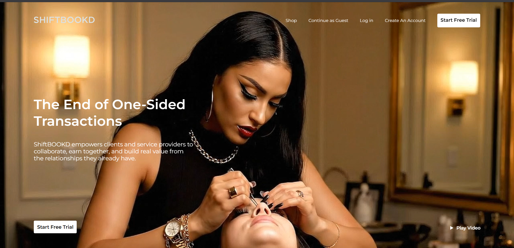
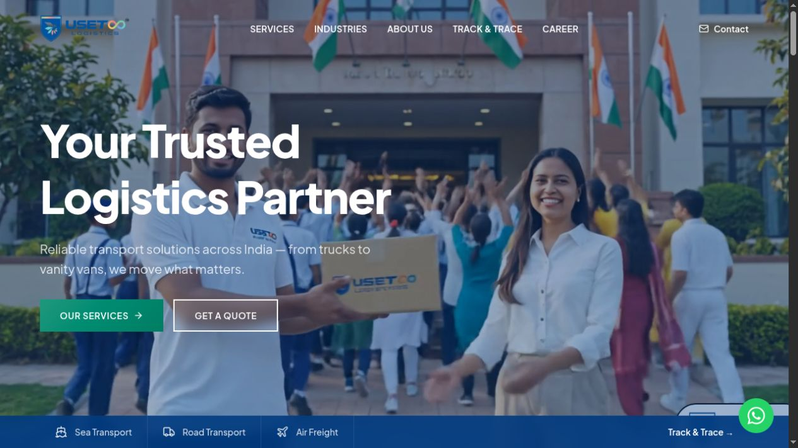

  <a href="https://hv443-portfolio.vercel.app/"><strong>Portfolio</strong></a> &nbsp; · &nbsp;
  <a href="https://linkedin.com/in/hv443"><strong>LinkedIn</strong></a> &nbsp; · &nbsp;
  <a href="mailto:vishwakarmaharsh443@gmail.com"><strong>Email me</strong></a>

## Hi, I'm Harsh

I'm a **Software Developer based in Mumbai, India**, focused on frontend engineering with **React, Next.js, and TypeScript**. I build responsive interfaces, manage application state, and connect products to APIs and real-time services.

My work spans booking platforms and logistics products—from responsive interfaces and application state to API integration and real-time communication.

**Interested in frontend and full-stack opportunities.** [Let's connect →](mailto:vishwakarmaharsh443@gmail.com)

## Technical skills

**Frontend engineering**

   &nbsp;
   &nbsp;
   &nbsp;
   &nbsp;
   &nbsp;
   &nbsp;
   &nbsp;
   &nbsp;
   &nbsp;

React · Next.js · TypeScript · JavaScript · HTML5 · CSS3 · Tailwind CSS · Redux · SCSS

**Backend & integration**

   &nbsp;
   &nbsp;
   &nbsp;

Node.js · Express · REST APIs · Socket.io · Firebase

**Mobile development**

   &nbsp;
   &nbsp;

Flutter · Dart · GetX · Location API integration

**Version control & deployment**

   &nbsp;
   &nbsp;
   &nbsp;
   &nbsp;

Git · GitHub · AWS EC2 · S3 · CloudFront · Vercel

## Selected work

### ShiftBOOKD · Booking & communication

Built responsive React interfaces for bookings, profiles, and messaging. Managed application state with Redux, integrated REST APIs and real-time chat with Socket.io, and deployed the application on AWS EC2.

**React · TypeScript · Redux · Socket.io**

[View in my portfolio ↗](https://hv443-portfolio.vercel.app/)

### UseToo Logistics · Logistics & tracking

Work across a logistics website and mobile workflows, with interfaces for services, shipment tracking, and customer interactions.

**Next.js · React · Tailwind CSS**

[View in my portfolio ↗](https://hv443-portfolio.vercel.app/)

## Get in touch

For roles involving React, TypeScript, or full-stack product development, reach me at **[vishwakarmaharsh443@gmail.com](mailto:vishwakarmaharsh443@gmail.com)**.

[Explore my portfolio](https://hv443-portfolio.vercel.app/) · [Connect on LinkedIn](https://linkedin.com/in/hv443)
