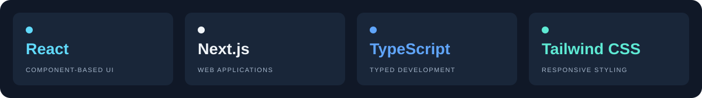
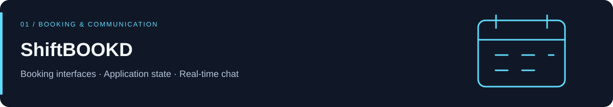
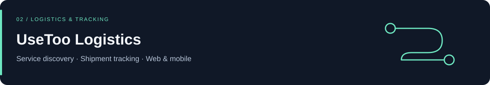
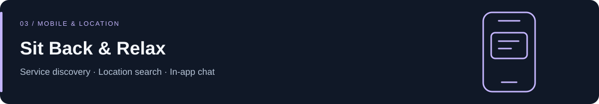

  <a href="https://hv443-portfolio.vercel.app/"><strong>Portfolio</strong></a> &nbsp; · &nbsp;
  <a href="https://linkedin.com/in/hv443"><strong>LinkedIn</strong></a> &nbsp; · &nbsp;
  <a href="mailto:vishwakarmaharsh443@gmail.com"><strong>Email me</strong></a>

## Hi, I'm Harsh

I'm a **Software Developer based in Mumbai, India**, focused on frontend engineering with **React, Next.js, and TypeScript**. I build responsive interfaces, manage application state, and connect products to APIs and real-time services.

My work spans booking platforms, logistics products, and home-service applications—from responsive interfaces and application state to API integration and real-time communication.

**Interested in frontend and full-stack opportunities.** [Let's connect →](mailto:vishwakarmaharsh443@gmail.com)

## Core stack

**Supporting tools:** Redux · REST APIs · Socket.io · Git

## Selected work

Built responsive React interfaces for bookings, profiles, and messaging. Managed application state with Redux, integrated REST APIs and real-time chat with Socket.io, and deployed the application on AWS EC2.

**React · TypeScript · Redux · Socket.io**

[View in my portfolio ↗](https://hv443-portfolio.vercel.app/)

Work across a logistics website and mobile workflows, with interfaces for services, shipment tracking, and customer interactions.

**Next.js · React · Tailwind CSS**

[View in my portfolio ↗](https://hv443-portfolio.vercel.app/)

Built a Flutter application connecting customers with service providers. Integrated location-based discovery, GetX state management, and in-app communication.

**Flutter · Dart**

[View in my portfolio ↗](https://hv443-portfolio.vercel.app/)

## Get in touch

For roles involving React, TypeScript, or full-stack product development, reach me at **[vishwakarmaharsh443@gmail.com](mailto:vishwakarmaharsh443@gmail.com)**.

[Explore my portfolio](https://hv443-portfolio.vercel.app/) · [Connect on LinkedIn](https://linkedin.com/in/hv443)
